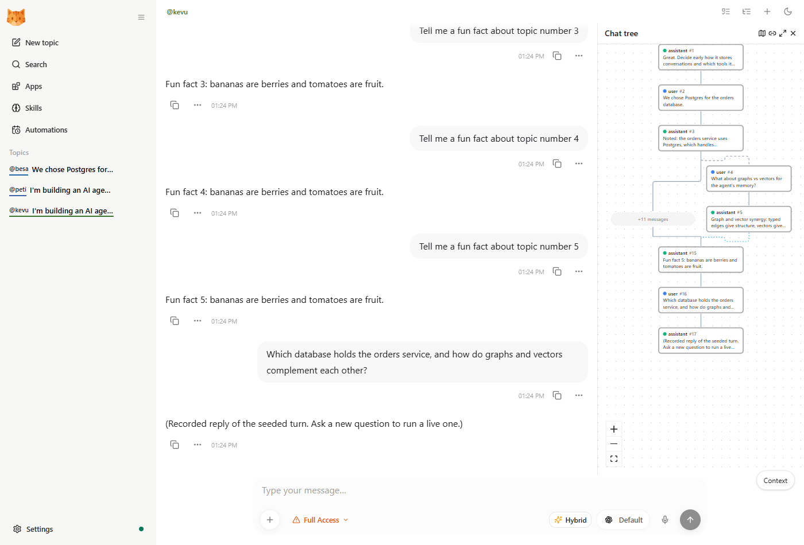
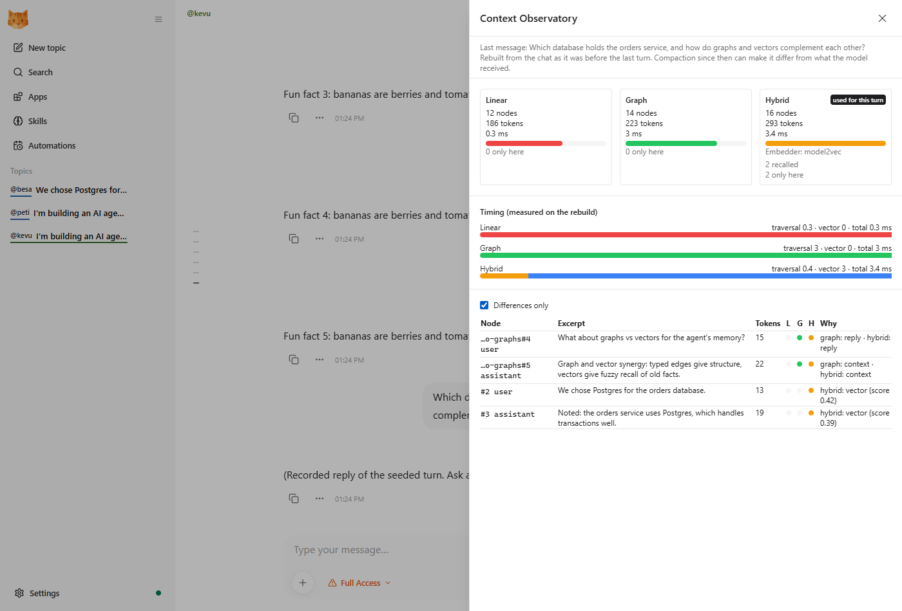
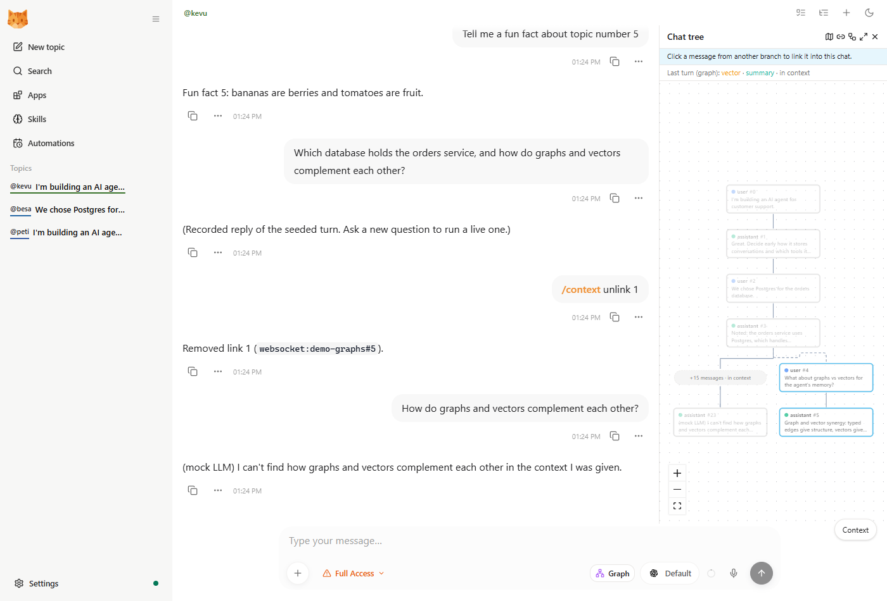
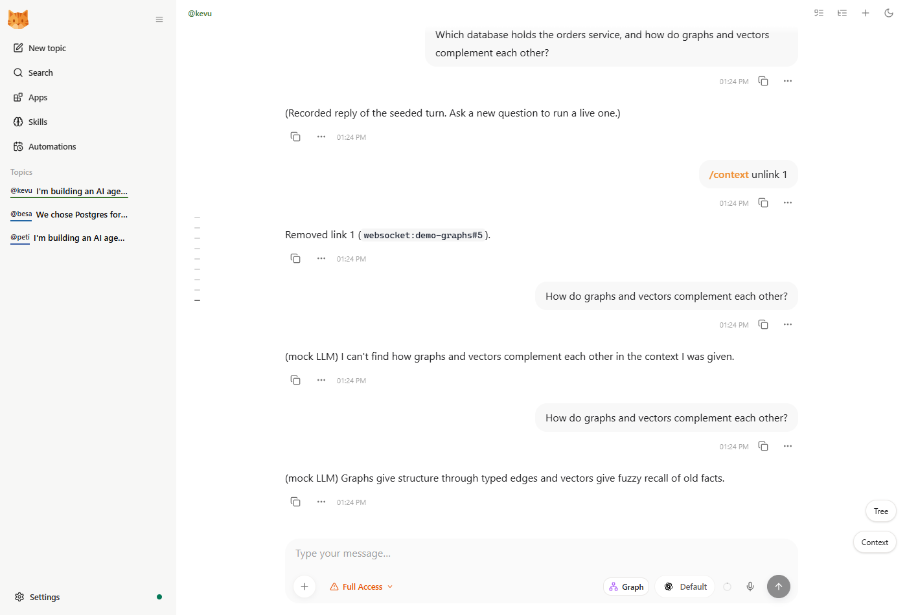
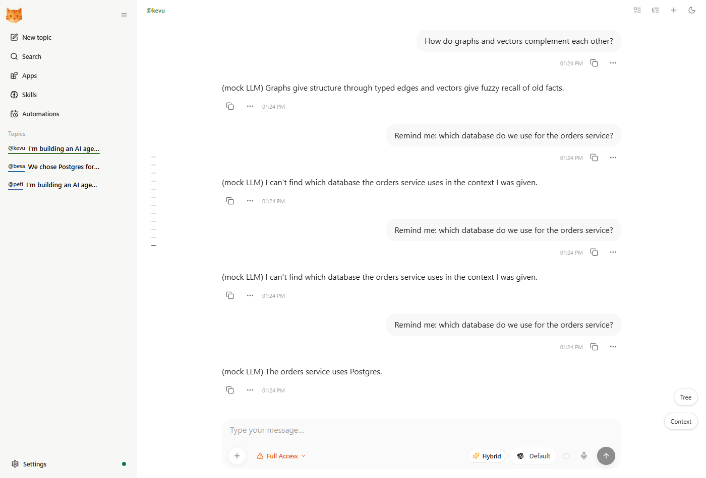
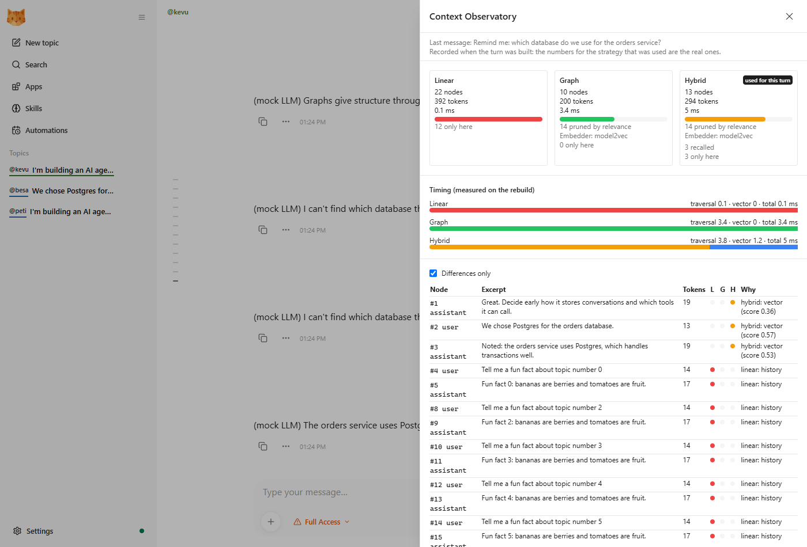
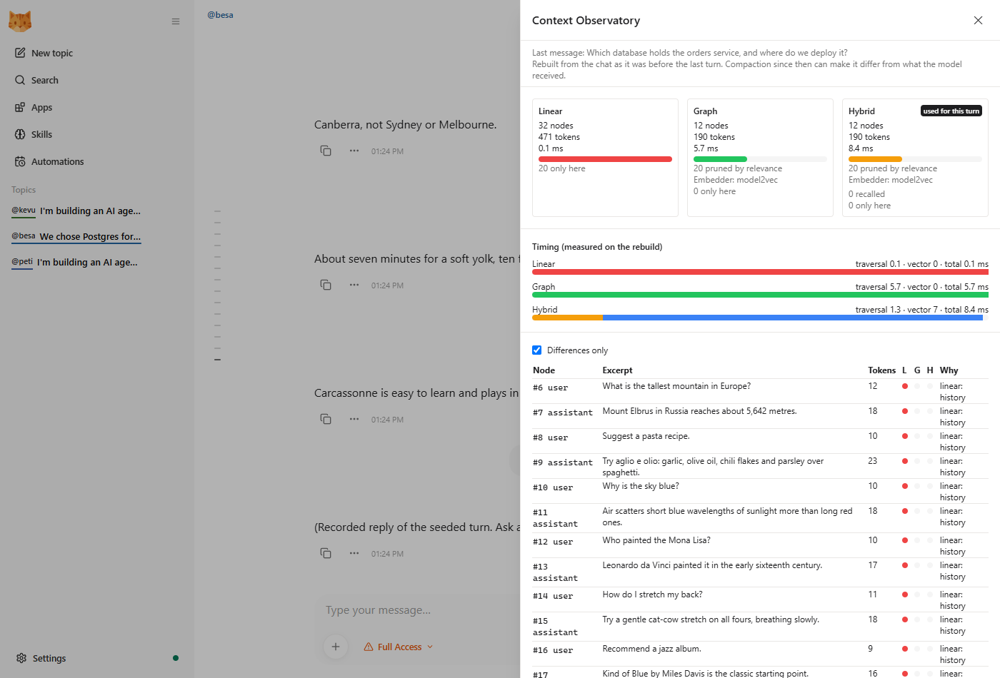
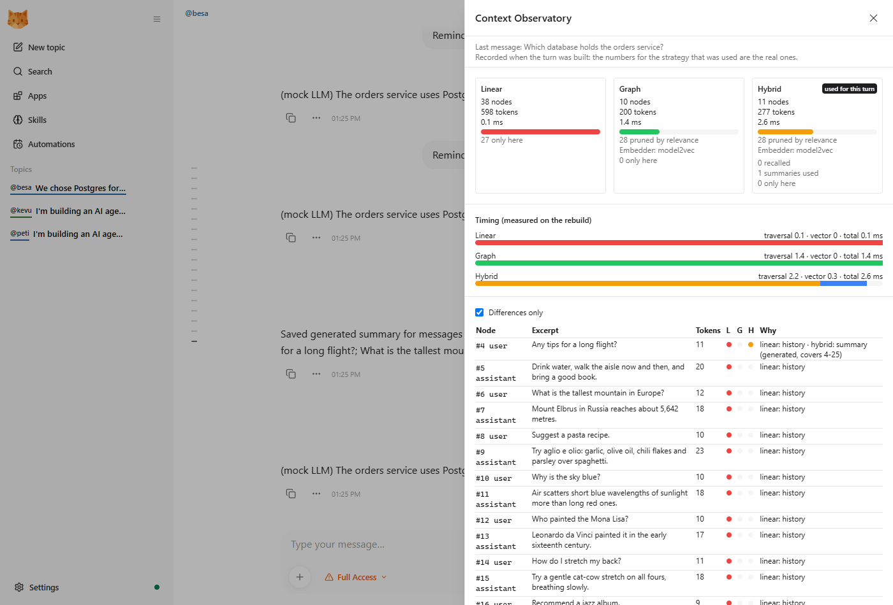

# demo.md: a different way to build an agent's context

Everything this student project added to [nanobot](README.md), why, how it helps, and how to run the demo. Written 2026-10-19. The change history is in [log.md](log.md); the per-phase design notes and measurements are in `docs/` (see section 9).

## 0. The whole thing in one minute

**Goal.** Show a different way of building an LLM's context. Instead of replaying one flat transcript (**linear**, how upstream nanobot works), the agent walks a **typed-edge DAG of the conversation** (replies, forks, links) and can add **semantic recall** and **summaries**. One toggle switches between the ways, and an Observatory shows what each puts in the context.

**Claim to prove: complete AND selective.** The graph-based strategies (1) recover context that linear misses (other branches, facts compacted away) and (2) drop irrelevant noise at a smaller token cost, with the same answer.

**Result on the scripted chats** (section 6): in the noise chat, linear sends 32 messages / 471 tokens and graph/hybrid send 12 / 190 with the same four relevant messages (**60% fewer tokens, 20 fewer unrelated messages, identical answer**). In the merge chat, linear finds 0 of 4 relevant messages, graph 2 of 4, hybrid 4 of 4.

**Run it** (mock model, nothing to pay for; details in section 3):

```text
python -m scripts.demo_setup <dir> --provider mock
python -m nanobot.context_graph.embed --config <dir>/config.json
python -m scripts.mock_llm --log <dir>/mock.jsonl        (leave running)
python -m scripts.preflight -c <dir>/config.json
python -m nanobot gateway -c <dir>/config.json           (then open http://127.0.0.1:8775, password: demo)
```

## 1. The three strategies

| Strategy | What the model sees | Switch with |
|---|---|---|
| `linear` (default, baseline) | The chat's history, as upstream nanobot does it. | the toggle next to the model picker, or `/context linear` |
| `graph` | History gathered by walking the conversation DAG: through forks into the chats they came from, through manual links, never into sibling branches. If a token budget is set, older turns are kept by relevance to the current message instead of just the newest. | `/context graph` |
| `hybrid` | `graph`, plus a labelled "[Recalled Context]" block in the system prompt: earlier messages similar to the current one and summaries standing in for dropped ranges. | `/context hybrid` |

## 2. Everything that was added, and why

Each row: **what**, **why it exists**, **how it helps the claim**, **where in the code**. Phase numbers match [log.md](log.md).

| Phase | What | Why / how it helps | Where |
|---|---|---|---|
| 1 | **Strategy toggle and `/context`**; every context build returns a structured result (node ids, reasons, token count, timing, diagnostics) | The comparison needs one switch and a way to see what was used | `nanobot/context_graph/observability.py`, `command/builtin.py`, `ContextStrategyBadge.tsx` |
| 2 | **Branching**: fork a chat from any message; the message menu's "Fork" | A conversation really is a tree; branches are what linear history cannot represent | `SessionManager.fork_session_before_user_index`, `nanobot/webui/forking.py` |
| 3 | **The typed-edge DAG**: nodes are addresses `(chat, message number)` (no copying), edges are `REPLY`, `BRANCH`, `CONTEXT`; a resolver collects ancestors; the engine budgets and falls back to linear on any failure | The one new core idea: context follows structure, not position. Reaches back through forks even where a fork's copy was trimmed | `context_graph/model.py`, `resolver.py`, `derive.py`, `engines.py` |
| 3.5 | **Chat tree**: a pan/zoom map of the whole chat family; click a node to open it; send from an earlier node to branch there | Makes the DAG visible and operable in the demo | `context_graph/tree.py`, `ChatMinimap.tsx`, `lib/chat-tree.ts` |
| 4 | **Hybrid**: a local embedder scores earlier messages against the current one; the best ones (and manual summaries) go in one labelled system-prompt block; pools `archived` / `family`; `/context summary` | Recovers facts the replay no longer contains (compacted away). Never splices raw messages, so replay legality cannot break | `context_graph/embed.py`, `recall.py`, `summaries.py` |
| 5 | **Workflow trace**: after each graph/hybrid turn, a small DAG of the steps that built its context (strategy, traversal, search in parallel, merge, prompt, call) with `TRIGGERS`/`FEEDS` edges, drawn in the tree behind a "Workflow" toggle | Observability: shows how a turn's context came to be. It never reaches the prompt | `context_graph/workflow.py` |
| 6 | **Context Observatory**: a drawer comparing linear, graph and hybrid for a chat's last turn (nodes, tokens, ms, why each node is in, "differences only"), a per-turn log line, a seeded demo chat family | The "explainable" half: every node comes with a reason, and differences are one click away | `context_graph/observatory.py`, `ContextObservatory.tsx`, route `/api/sessions/{key}/context-result`, `scripts/seed_demo.py` |
| 7 | **Selective context**: an optional real local embedder (model2vec, with a hashed-words fallback), a **graph token budget** and **relevance-pruned replay** (keep the newest turns, then the older turns most similar to the question, whole turns so tool calls stay with their results), a per-embedder recall cut-off, a noise demo | The "selective" half: smaller context, same answer. Without this the graph replays as much as linear | `context_graph/prune.py`, `embed.py`, `engines.py`, config `graphTokenBudget`, `keepRecentTurns`, `semanticEmbedder` |
| 8 | **Linking and one toggle**: `/context link <chat>#<n>`, `links`, `unlink`, and a Tree "link mode"; the duplicate header toggle is gone | Creates the DAG's `CONTEXT` edges live (a merge); removes a redundant control | `context_graph/links.py`, `ChatMinimap.tsx` |
| 9 | **Exact Observatory**: the loop records the comparison at turn time (the used strategy's numbers are the real ones) instead of rebuilding it later | A rebuild drifts after compaction; the recording cannot. The headline numbers are now exact | `observatory.compare`, config `recordComparison` |
| 10 | **LLM summaries**: `/context summarize <from> <to>`; in hybrid mode turns covered by a stored summary are the first dropped | Smaller context with the meaning kept. Deliberately not the Memory summarizer (that one writes into durable memory) | `context_graph/summarize.py`, `summaries.py` |
| 11 | **Demo kit**: a deterministic context-sensitive mock model, a preflight check, a one-command instance setup, final seed scenarios, this file | A live demo fails on the network first; the kit makes it repeatable and safe | `scripts/` |

**Bugs found and fixed along the way** (each has a regression test; see [docs/REVIEW-LATER.md](docs/REVIEW-LATER.md)): the WebUI sessions list never returned the chosen strategy (the toggle reset on every reload since Phase 1); `ToolsConfig` / `Config.model_validate` failing when `nanobot.context_graph` was imported first; the original thread header had been replaced by a stripped one (theme toggle, prompt navigator, session info silently gone); graph and hybrid fell back to linear after any slash command, which also skipped hybrid recall and shifted node ids; `/context link` failed right after any other `/context` command; summaries silently unused when pruning kept part of their range; an explicit model2vec setting contacted the network on every start and stalled the first turn; tests behaved differently on machines that had the semantic model downloaded.

## 3. Setup (once)

You need Python 3.11+ with the project's virtual environment (`uv sync`), [bun](https://bun.sh) for the WebUI build, and a browser. All dependencies stay local to the project (`uv`, `bun`); nothing is installed globally. The demo uses its **own instance directory** (own config, data and ports), so it never touches your real nanobot chats or a gateway you already run (this repo's default ports are 8765 and 18790; the demo uses 8775 and 18795).

**1. Dependencies and the WebUI build**

```powershell
uv sync --extra semantic          # the optional semantic embedder; if a gateway is running from this .venv, stop it first
cd webui; bun install; bun run build; cd ..     # writes nanobot/web/dist (git-ignored)
.venv\Scripts\Activate.ps1        # bash: source .venv/bin/activate
```

**2. The demo instance**, with the mock model or a real one:

```powershell
python -m scripts.demo_setup C:\demo --provider mock                     # no key, nothing to pay for
python -m scripts.demo_setup C:\demo --provider zen --model <zen-model-id>   # OpenCode Zen
```

This writes `C:\demo\config.json` (idle compaction off, graph budget 200 tokens, recording on) and seeds the three demo chats. With `--provider zen` the key is referenced as `${OPENCODE_API_KEY}` and read from the environment; it is never written to disk:

```powershell
$env:OPENCODE_API_KEY = "<your key>"      # bash: export OPENCODE_API_KEY=...
```

**Choosing the Zen model.** Take the exact id from the [OpenCode Zen docs](https://opencode.ai/docs/zen/) (pass it without or with the `opencode/` prefix). Free models are "free for a limited time" and rotate, and **your demo chats go to the provider**, so prefer one the page lists as zero retention and no training (on 2026-10-19: GLM-5.3-Flash Free, DeepSeek V4.1 Flash Free, Space Bunny Free, LongCat 2.5 Preview Free; others may use data to improve the model). Zen documents no embeddings endpoint, which is why the embedder runs locally.

**3. The semantic model** (about 30 MB, once; it goes into the instance's own directory):

```powershell
python -m nanobot.context_graph.embed --config C:\demo\config.json
```

Without it the demo still runs on hashed words (shared-word matching, no meaning); the preflight tells you which one will run.

**4. Preflight**, which checks the provider and key (never printed), embedder, WebUI build, ports, demo settings and seeded chats:

```powershell
python -m scripts.preflight -c C:\demo\config.json --live     # --live makes one tiny real model call
```

Fix every `FAIL`; a `WARN` is information (e.g. a port in use because the demo is already running).

## 4. Commands

| Do | Command |
|---|---|
| Start the mock model (only for `--provider mock`; leave running) | `python -m scripts.mock_llm --log C:\demo\mock.jsonl` |
| Start the demo | `python -m nanobot gateway -c C:\demo\config.json`, then open <http://127.0.0.1:8775> and log in with the password `demo` |
| Stop | Ctrl+C in each window |
| Print the comparison table for the seeded chats | `python -m scripts.seed_demo <new-workspace> --report` (a scratch workspace; it refuses to seed twice) |
| Start over | delete `C:\demo` and run `demo_setup` again |

In the chat: `/context` (show state), `/context linear|graph|hybrid`, `/context hybrid archived|family|default`, `/context summary <from> <to> <text>`, `/context summarize <from> <to>`, `/context link <chat key>#<n> [<m>]`, `/context links`, `/context unlink <n>`. Message numbers are the node numbers in the Tree and the Observatory. Full list: [docs/chat-commands.md](docs/chat-commands.md); settings: [docs/configuration.md](docs/configuration.md#context-graph-experimental).

## 5. The demo script

The setup creates three chats. Two share the title "I'm building an AI age…": the one with the long "fun fact" run is **demo-root**, the other is its branch **demo-graphs**. **demo-noise** ("We chose Postgres for…") is one long chat. All numbers below come from the mock-model rehearsal of exactly these steps; with a real model the answers are worded differently but the context sizes are identical (context building does not depend on the model).

**Open demo-root** (it starts in `hybrid`). Its Postgres decision was compacted away, and a branch was merged in.

**Act 1: the family and the seeded turn (2 min).** Press **Tree**: the root chain, the branch hanging off it, and the merge as a dotted blue edge. Close it, press **Context**, tick **Differences only**.
Expect: Linear 12 nodes / 186 tokens, Graph 14 / 223, Hybrid 16 / 293 (2 recalled). The rows only in graph and hybrid are the branch (reason `context`: the merge); the rows only in hybrid are the archived Postgres exchange (reason `vector (score …)`). The label says "Rebuilt…" because the seeded turn was not run live.



**Act 2: create the merge live (3 min).** Switch to `graph` (the toggle by the model picker). Type `/context unlink 1`. Ask `How do graphs and vectors complement each other?` → *"(mock LLM) I can't find how graphs and vectors complement each other in the context I was given."* Open **Tree**, press the link button (chain icon) in the panel header, click the branch's last message (the blue-ringed `assistant #5`), wait for "Linked…". Ask the same question again → *"(mock LLM) Graphs give structure through typed edges and vectors give fuzzy recall of old facts."*



**Act 3: recall of an archived fact (3 min).** Ask `Remind me: which database do we use for the orders service?` three times, in this order (each answer is added to the history, so the order matters): switch to `linear`, ask; `graph`, ask; `hybrid`, ask.
Expect: linear and graph → *"I can't find which database the orders service uses…"*; hybrid → *"The orders service uses Postgres."* (the recalled block carried it; the Postgres messages were compacted out of every replay). Press **Context**: this turn is **recorded** ("Recorded when the turn was built…"): Linear 22 nodes / 392 tokens, Graph 10 / 200, Hybrid 13 / 294 (3 recalled).



**Act 4: noise, the selective half (3 min).** Open **demo-noise**, press **Context**, tick **Differences only**. Expect: Linear 32 nodes / 471 tokens, Graph and Hybrid 12 / 190, each with "20 pruned by relevance" and the embedder name; the rows only in linear are the small talk. Now ask `Remind me which database holds the orders service and where we deploy it.` under `linear`, then under `hybrid`: **both answers are identical** (*"The orders service uses Postgres. It is deployed to Fly.io in Frankfurt."*), but the recorded sizes are Linear 34 nodes / 512 tokens against Hybrid 10 / 188.


**Act 5: a model-written summary (2 min).** Still in demo-noise: type `/context summarize 4 25` (the small-talk range). The reply says "Saved generated summary for messages 4-25: …". Ask `Which database holds the orders service?`. Press **Context**: the hybrid card reads "1 summaries used" and a row shows `hybrid: summary (generated, covers 4-25)`; the model request carried `[generated summary of messages 4-25]` and none of the small talk. (The summary costs tokens: this turn is 277 tokens against 188 without it. That is the price of keeping the gist.)


**If something goes wrong on stage:** the mock model works offline and gives the same demonstrations; the Observatory shows context, not answers. If a chat misbehaves, `/context` shows its state; to reset everything delete the instance directory and run `demo_setup` again.

## 6. The numbers

**Merge chat** (`python -m scripts.seed_demo <workspace> --scenario merge --report`; four messages are relevant to the question: the archived Postgres exchange and the branch exchange).

| Strategy | Nodes | Tokens | Relevant found | Other messages |
|---|---:|---:|---:|---:|
| linear | 12 | 186 | 0 / 4 | 12 |
| graph | 14 | 223 | 2 / 4 | 12 |
| hybrid | 16 | 293 | 4 / 4 | 12 |

Linear sees neither the archived decision nor the other chat. Graph follows the merge edge but cannot reach the compacted decision. Hybrid recalls it by similarity. This half shows the strategies are *more complete*, not smaller.

**Noise chat** (`--scenario noise`; the pass criteria were written before the scenario was built: graph and hybrid find at least as many relevant messages as linear, with strictly fewer unrelated messages and no more tokens).

| Strategy | Nodes | Tokens | Relevant found | Unrelated |
|---|---:|---:|---:|---:|
| linear | 32 | 471 | 4 / 4 | 28 |
| graph, budget 200 | 12 | 190 | 4 / 4 | 8 |
| hybrid, budget 200 | 12 | 190 | 4 / 4 | 8 |

**Budget sweep** (so the result does not hinge on one number; both embedders; tokens graph / linear and relevant found by graph): at budgets 150, 200, 250, 300, 350, 400 and 470 graph keeps 4 of 4 relevant messages with 132, 190, 248, 299, 328, 379 and 444 tokens against linear's 471. At 100 tokens graph alone drops to 2 of 4 and hybrid's recall brings the other two back. **The demo budget of 200 was chosen after this sweep** (about 40% of the full history); the first value written down (350) also met the criteria with a smaller saving.

**Live rehearsal** (section 5, mock model): the same question gets different answers under linear, graph and hybrid (acts 2 and 3); under linear and hybrid it gets the *same* answer with 512 against 188 tokens (act 4).

## 7. Honest limits

- **Scripted chats, not conversations in general.** The criteria are about these scenarios. In a short, unforked chat the three strategies look alike.
- **The baseline is generous to the claim in one way.** Idle compaction is off in the demo config so the seeded chats keep their history; upstream's default compacts idle chats after 15 minutes, which would also shrink linear (and lose the archived facts, which is the "complete" half of the story).
- **"Selective" comes from a heuristic.** Relevance pruning ranks whole turns by similarity to the question; a dropped turn can be one the question needed (at a 100-token budget graph alone lost two relevant messages in the sweep). The recall cut-off of 0.30 for the semantic model was set from this scenario's score distribution (unrelated text up to about 0.21, real matches from about 0.39), not a general calibration.
- **The semantic embedder is small and static.** It matches meaning better than hashed words ("car" ~ "automobile" 0.78 against "car" ~ "banana" 0.04), but it is not a large model.
- **Token counts are estimates** (the project's own estimator, not the provider's meter).
- **The seeded Observatory views are rebuilds** (labelled "Rebuilt…"); every live turn is recorded and exact. Recording costs two extra context builds per turn (`recordComparison: false` turns it off).
- **Summaries only matter over the budget**, and the mock writes a generic summary ("Summary of 22 messages. The user asked: …"). Real summary quality depends on the model and has **not** been judged by me.
- **What I did not run: a real model.** The whole rehearsal used the mock (the mock is clearly labelled "(mock LLM)" in every answer). Context building, the Observatory, links and summaries do not depend on the model, but the real-provider path (OpenCode Zen key, model id, latency, rate limits) is untested: run `scripts.preflight --live` before the demo.
- **Translations** of the new WebUI labels in nine languages are machine-generated.

## 8. Troubleshooting

| Symptom | Likely cause and fix |
|---|---|
| Preflight `FAIL provider … no API key found (OPENCODE_API_KEY is not set)` | Set the variable in the same terminal that runs the preflight and the gateway |
| Preflight `FAIL provider … nothing answers` | Start the mock: `python -m scripts.mock_llm` |
| Preflight `WARN embedder: hashed words will run` | Run the model download of section 3, step 3 (it must use `--config` of the demo instance) |
| `FAIL WebUI build` | `cd webui; bun run build` |
| `WARN port … in use` | Fine if the demo is already running; otherwise stop the other program or pass other ports to `demo_setup` |
| `uv sync` fails replacing `nanobot.exe` | A gateway started from this venv is still running: stop it, or `uv sync --extra semantic --no-install-project --inexact` |
| A chat's history looks empty after you stepped away | Idle compaction: the demo config sets it to 0; check `agents.defaults.idleCompactAfterMinutes` |
| Graph shows `0 nodes` and "Fell back…" | The Observatory states the reason; `/context` shows the chat's state |
| The same question answered twice in a row looks odd | Seeded chats end with an answered turn on purpose; do not seed a chat that ends in an unanswered question and then repeat it (the provider layer merges consecutive user messages) |
| First hybrid turn is slow | The semantic model loads once per process (about a second) |

## 9. Slide outline

1. **Problem.** A conversation is a graph (branches, merges, side questions) but chat history is a flat list. *Show: the Tree of demo-root next to its linear transcript.*
2. **Limits of linear history.** Missing context (other branches, compacted facts) and unrelated context (small talk that always comes along). *Show: act 3, the "can't find" answers.*
3. **Graph representation.** Nodes are addresses into the session store; typed edges `REPLY`, `BRANCH`, `CONTEXT`; a resolver collects ancestors. *Show: the dotted merge edge.*
4. **Context engine.** Derive the DAG per turn, resolve ancestors, budget and legality through existing replay code, optional recall block, fallback to linear on any failure. Phases 3 to 5 in one diagram.
5. **Selective: relevance pruning.** Keep the newest turns, rank older turns by similarity to the question. *Show: act 4 and the budget sweep (tokens against budget, relevant found staying at 4 of 4).*
6. **Complete: hybrid recall and summaries.** Recovering compacted facts; a model-written summary standing in for small talk. *Show: acts 3 and 5.*
7. **Linking.** Create a merge live. *Show: act 2, before and after.*
8. **Explainable: the Observatory.** Every node has a reason; recorded, exact numbers. *Show: the "Differences only" screenshots.*
9. **Results.** The two tables of section 6. State the limits of section 7.
10. **Conclusion and future work.** Graph-based context is structured, explainable, more complete and, with a budget, smaller at the same answer. Future work: a larger embedder, judging real summaries, automatic summaries on compaction, side-by-side chat panes, a bigger and less scripted evaluation.

## 10. Where to read more

[log.md](log.md) (every change and its checks) · [docs/PHASES7-11-PLAN.md](docs/PHASES7-11-PLAN.md) (plans, decisions and measurements for phases 7 to 11, sections 10 to 14 are the as-built notes) · [docs/PHASE3-PLAN.md](docs/PHASE3-PLAN.md), [PHASE3_5](docs/PHASE3_5-PLAN.md), [PHASE4](docs/PHASE4-PLAN.md), [PHASE5](docs/PHASE5-PLAN.md), [PHASE6](docs/PHASE6-PLAN.md) · [docs/REVIEW-LATER.md](docs/REVIEW-LATER.md) (open items and decisions to revisit) · [MasterGuide-v3.md](MasterGuide-v3.md) (the original spec) · [docs/configuration.md](docs/configuration.md) and [docs/chat-commands.md](docs/chat-commands.md).
